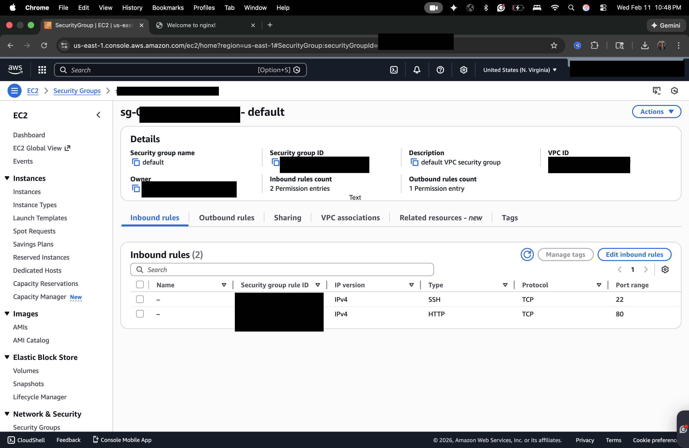
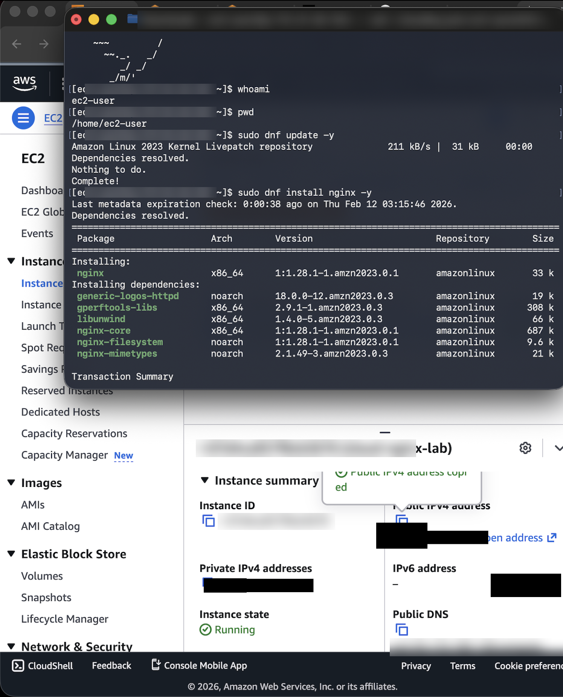
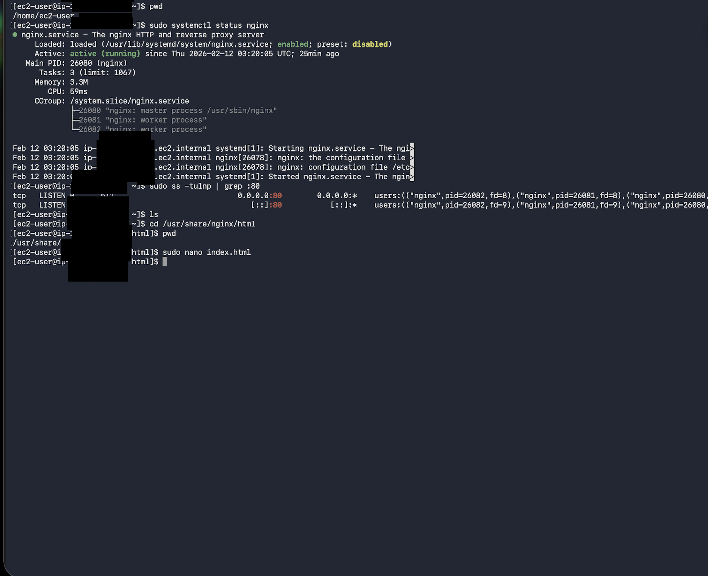
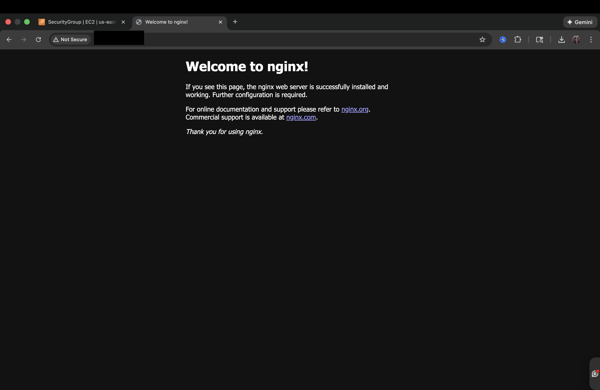
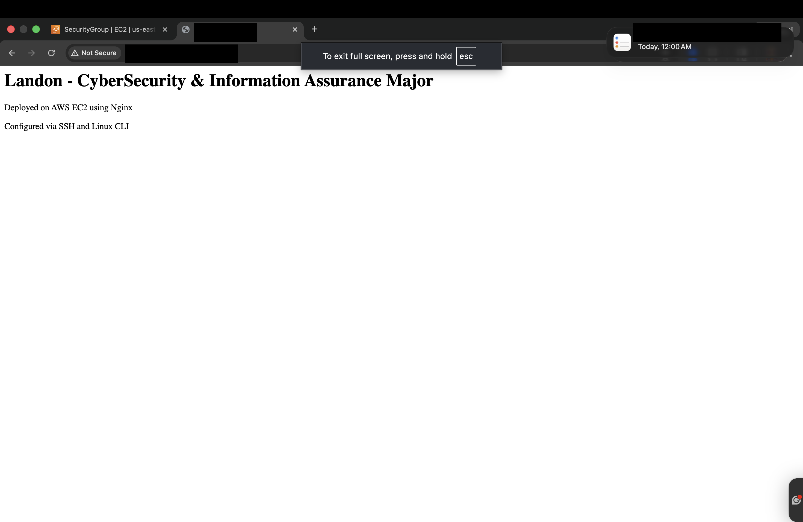

# AWS Cloud Lab: Deploying a Web Server on EC2

I wanted hands-on time in AWS, not just reading about it. So I launched my own server in the cloud, connected to it from my laptop, put a web server on it, and controlled exactly what traffic could reach it.

This lab lives in my personal AWS account. Account IDs, IP addresses, and instance details are blurred in every screenshot.

---

## What I built

- An **EC2 instance** (a virtual server in AWS) running **Amazon Linux 2023**, named `cloud-nginx-lab`
- **SSH access with a key pair** instead of a password
- A **security group** (AWS's firewall for the server) that only lets in two kinds of traffic
- An **Nginx web server** serving a custom page

---

## What I did and why

### 1. Launched the server with a key pair

I created an EC2 instance on Amazon Linux 2023 and had AWS generate a key pair. AWS keeps the public key on the server, and I keep the private key file on my laptop.

**Why I did it:** A key pair is a lot stronger than a password. A password can be guessed or reused from a breach. To get in with a key pair, you need the actual private key file, and that file never leaves my machine.

### 2. Locked down the firewall

**EC2 > Security Groups > Inbound rules**

| Type | Port | Why it's open |
|---|---|---|
| SSH | 22 | So I can log in and manage the server |
| HTTP | 80 | So people can see the website |

Everything else is blocked by default.

**Why I did it:** Every open port is another door into the server. I only opened the two the server actually needs. If a port isn't in this list, traffic on it never reaches the server.



### 3. Connected over SSH and patched first

I connected from my terminal with my private key, then checked who I was logged in as and where I was before touching anything.

```bash
ssh -i cloudkey.pem ec2-user@<public-ip>
whoami
pwd
sudo dnf update -y
```

- `ssh` = secure shell, an encrypted connection to the server
- `-i cloudkey.pem` = use my private key file to prove who I am
- `ec2-user@<public-ip>` = the user to log in as, and the server's address
- `whoami` = shows which user I'm logged in as
- `pwd` = print working directory, shows which folder I'm in
- `sudo` = run the command with admin rights
- `dnf` = Amazon Linux's package manager, the tool that installs and updates software
- `update` = update everything already installed
- `-y` = automatically say yes to the prompts

**Why I did it:** I update before I install anything. A brand new server can still have outdated packages with known vulnerabilities, so patching first means I'm not building on top of holes.

### 4. Installed Nginx and confirmed it was running

```bash
sudo dnf install nginx -y
sudo systemctl status nginx
sudo ss -tulpn | grep :80
```

- `install nginx` = installs the Nginx web server
- `systemctl` = the tool that manages services on Linux
- `status nginx` = shows whether Nginx is running and enabled to start on boot
- `ss` = socket statistics, shows which ports are open and listening
- `-t` = TCP connections
- `-u` = UDP connections
- `-l` = only show ports that are listening
- `-p` = show which program owns each port
- `-n` = show port numbers instead of names
- `| grep :80` = filter the results down to port 80

**Why I did it:** I didn't just trust that the install worked. `systemctl` proved Nginx was running and set to start automatically after a reboot. `ss` proved port 80 was open and that Nginx was the program listening on it, which matched what I allowed in the security group.





### 5. Served the page

First I loaded the server's address in my browser and got the default Nginx page. Then I edited the homepage file to make it my own.

```bash
cd /usr/share/nginx/html
sudo nano index.html
```

- `cd` = change directory, move into the folder Nginx serves pages from
- `nano` = a simple text editor in the terminal
- `index.html` = the homepage file





---

## What I'd tighten before this went live

The browser shows **"Not Secure"** on my page, and that's on purpose for this lab. Here's what I'd fix for a real server:

- **Turn on HTTPS.** Right now traffic travels over plain HTTP, so anything sent to the site could be read along the way. I'd generate a TLS certificate and serve the site over port 443 instead.
- **Limit who can SSH in.** I'd set the SSH rule's source to only my IP address, so the rest of the internet can't even try to log in.
- **Use a dedicated security group.** I used the default security group for this lab. In a real setup, each server gets its own group with its own rules, so changing one doesn't affect others.
- **Shut it down when I'm done.** I did this one. Once I finished the lab, I shut the server down, because a server that's running and not needed is cost and attack surface for no reason.

---

## Skills used

AWS EC2, Amazon Linux 2023, security groups, SSH key pair authentication, Linux CLI, package management with dnf, Nginx, systemd service management, checking listening ports with ss, and explaining security decisions in plain language.
